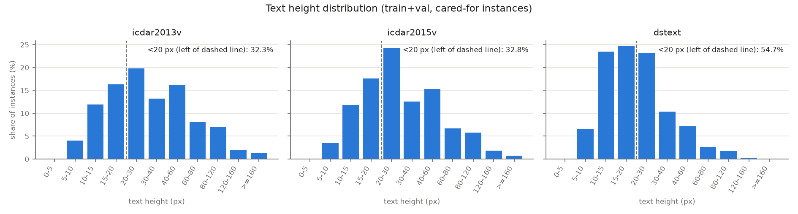
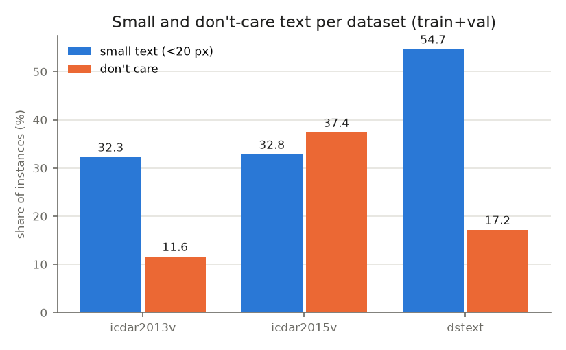

# Data report

## Inventory

### 2026-10-26 - `tools/inventory.py --root data/raw`

| dataset | split | videos | expected | GT xml | matched | video w/o GT | GT w/o video | aux txt |
|---|---|---|---|---|---|---|---|---|
| icdar2013v | test | 15 | - | 15 | 15 | 0 | 0 | 0 |
| icdar2013v | train | 13 | - | 13 | 13 | 0 | 0 | 0 |
| icdar2013v | total | 28 | 28 | 28 | 28 | 0 | 0 | 0 |
| icdar2015v | test | 24 | 24 | 0 | 0 | 24 | 0 | 24 |
| icdar2015v | train | 25 | 25 | 25 | 25 | 0 | 0 | 50 |
| icdar2015v | total | 49 | 49 | 25 | 25 | 24 | 0 | 74 |
| dstext | test | 50 | 50 | 0 | 0 | 50 | 0 | 0 |
| dstext | train | 50 | 50 | 50 | 50 | 0 | 0 | 0 |
| dstext | total | 100 | 100 | 50 | 50 | 50 | 0 | 0 |

- **icdar2013v**: 28 videos, 28 GT xml -> OK
  - matched only case-insensitively (3): `train/Video_51_7_4.mp4 <-> train/video_51_7_4_GT.xml`, `train/Video_54_7_4.mp4 <-> train/video_54_7_4_GT.xml`, `train/Video_7_5_1.mp4 <-> train/video_7_5_1_GT.xml`
- **icdar2015v**: 49 videos, 25 GT xml -> OK
  - videos without GT xml (24): `test/Video_11_4_1.mp4`, `test/Video_15_4_1.mp4`, `test/Video_17_3_1.mp4`, `test/Video_1_1_2.mp4`, `test/Video_20_5_1.mp4`, `test/Video_22_5_1.mp4`, `test/Video_23_5_2.mp4`, `test/Video_24_5_2.mp4`, `test/Video_30_2_3.mp4`, `test/Video_32_2_3.mp4`, `test/Video_34_2_3.mp4`, `test/Video_35_2_3.mp4`, `test/Video_38_2_3.mp4`, `test/Video_39_2_3.mp4`, `test/Video_43_6_4.mp4`, `test/Video_44_6_4.mp4`, `test/Video_48_6_4.mp4`, `test/Video_49_6_4.mp4`, `test/Video_50_7_4.mp4`, `test/Video_53_7_4.mp4`, `test/Video_55_3_2.mp4`, `test/Video_5_3_2.mp4`, `test/Video_6_3_2.mp4`, `test/Video_9_1_1.mp4`
  - all 24 have only aux txt (vocabulary/transcripts, no boxes)
- **dstext**: 100 videos, 50 GT xml -> OK
  - videos without GT xml (50): `test/Activity/Video_162_6_2.mp4`, `test/Activity/Video_167_6_7.mp4`, `test/Activity/Video_171_7_1.mp4`, `test/Activity/Video_172_7_2.mp4`, `test/Activity/Video_174_7_4.mp4`, `test/Activity/Video_175_7_5.mp4`, `test/Activity/Video_178_7_8.mp4`, `test/Activity/Video_184_8_4.mp4`, `test/Driving/Video_223_2_3.mp4`, `test/Driving/Video_228_2_8.mp4`, `test/Driving/Video_230_3_0.mp4`, `test/Driving/Video_231_3_1.mp4`, `test/Driving/Video_232_3_2.mp4`, `test/Driving/Video_237_3_7.mp4`, `test/Driving/Video_239_3_9.mp4`, `test/Driving/Video_242_4_2.mp4`, `test/Game/Video_149_4_9.mp4`, `test/Game/Video_156_5_6.mp4`, `test/Sports/Video_105_0_5.mp4`, `test/Sports/Video_108_0_8.mp4`, `test/Sports/Video_112_1_2.mp4`, `test/Sports/Video_114_1_4.mp4`, `test/Street_View_Indoor/Video_192_9_2.mp4`, `test/Street_View_Indoor/Video_196_9_6.mp4`, `test/Street_View_Indoor/Video_197_9_7.mp4`, `test/Street_View_Indoor/Video_199_9_9.mp4`, `test/Street_View_Indoor/Video_202_0_2.mp4`, `test/Street_View_Indoor/Video_208_0_8.mp4`, `test/Street_View_Indoor/Video_209_0_9.mp4`, `test/Street_View_Indoor/Video_210_1_0.mp4`, `test/Street_View_Indoor/Video_211_1_1.mp4`, `test/Street_View_Indoor/Video_214_1_4.mp4`, `test/Street_View_Indoor/Video_216_1_6.mp4`, `test/Street_View_Indoor/Video_218_1_8.mp4`, `test/Street_View_Indoor/Video_220_2_0.mp4`, `test/Street_View_Indoor/Video_222_2_2.mp4`, `test/Street_View_Outdoor/Video_121_2_1.mp4`, `test/Street_View_Outdoor/Video_122_2_2.mp4`, `test/Street_View_Outdoor/Video_123_2_3.mp4`, `test/Street_View_Outdoor/Video_125_2_5.mp4`, `test/Street_View_Outdoor/Video_126_2_6.mp4`, `test/Street_View_Outdoor/Video_128_2_8.mp4`, `test/Street_View_Outdoor/Video_132_3_2.mp4`, `test/Street_View_Outdoor/Video_133_3_3.mp4`, `test/Street_View_Outdoor/Video_134_3_4.mp4`, `test/Street_View_Outdoor/Video_135_3_5.mp4`, `test/Street_View_Outdoor/Video_136_3_6.mp4`, `test/Street_View_Outdoor/Video_143_4_3.mp4`, `test/Street_View_Outdoor/Video_144_4_4.mp4`, `test/Street_View_Outdoor/Video_145_4_5.mp4`

### 2026-10-26 - `tools/inventory.py --root data/raw`

| dataset | split | videos | expected | GT xml | matched | video w/o GT | GT w/o video | aux txt |
|---|---|---|---|---|---|---|---|---|
| icdar2013v | test | 15 | - | 15 | 15 | 0 | 0 | 0 |
| icdar2013v | train | 13 | - | 13 | 13 | 0 | 0 | 0 |
| icdar2013v | total | 28 | 28 | 28 | 28 | 0 | 0 | 0 |
| icdar2015v | test | 24 | 24 | 0 | 0 | 24 | 0 | 24 |
| icdar2015v | train | 25 | 25 | 25 | 25 | 0 | 0 | 50 |
| icdar2015v | total | 49 | 49 | 25 | 25 | 24 | 0 | 74 |
| dstext | test | 50 | 50 | 0 | 0 | 50 | 0 | 0 |
| dstext | train | 50 | 50 | 50 | 50 | 0 | 0 | 0 |
| dstext | total | 100 | 100 | 50 | 50 | 50 | 0 | 0 |

- **icdar2013v**: 28 videos, 28 GT xml -> OK
  - matched only case-insensitively (3): `train/Video_51_7_4.mp4 <-> train/video_51_7_4_GT.xml`, `train/Video_54_7_4.mp4 <-> train/video_54_7_4_GT.xml`, `train/Video_7_5_1.mp4 <-> train/video_7_5_1_GT.xml`
- **icdar2015v**: 49 videos, 25 GT xml -> OK
  - videos without GT xml (24): `test/Video_11_4_1.mp4`, `test/Video_15_4_1.mp4`, `test/Video_17_3_1.mp4`, `test/Video_1_1_2.mp4`, `test/Video_20_5_1.mp4`, `test/Video_22_5_1.mp4`, `test/Video_23_5_2.mp4`, `test/Video_24_5_2.mp4`, `test/Video_30_2_3.mp4`, `test/Video_32_2_3.mp4`, `test/Video_34_2_3.mp4`, `test/Video_35_2_3.mp4`, `test/Video_38_2_3.mp4`, `test/Video_39_2_3.mp4`, `test/Video_43_6_4.mp4`, `test/Video_44_6_4.mp4`, `test/Video_48_6_4.mp4`, `test/Video_49_6_4.mp4`, `test/Video_50_7_4.mp4`, `test/Video_53_7_4.mp4`, `test/Video_55_3_2.mp4`, `test/Video_5_3_2.mp4`, `test/Video_6_3_2.mp4`, `test/Video_9_1_1.mp4`
  - all 24 have only aux txt (vocabulary/transcripts, no boxes)
- **dstext**: 100 videos, 50 GT xml -> OK
  - videos without GT xml (50): `test/Activity/Video_162_6_2.mp4`, `test/Activity/Video_167_6_7.mp4`, `test/Activity/Video_171_7_1.mp4`, `test/Activity/Video_172_7_2.mp4`, `test/Activity/Video_174_7_4.mp4`, `test/Activity/Video_175_7_5.mp4`, `test/Activity/Video_178_7_8.mp4`, `test/Activity/Video_184_8_4.mp4`, `test/Driving/Video_223_2_3.mp4`, `test/Driving/Video_228_2_8.mp4`, `test/Driving/Video_230_3_0.mp4`, `test/Driving/Video_231_3_1.mp4`, `test/Driving/Video_232_3_2.mp4`, `test/Driving/Video_237_3_7.mp4`, `test/Driving/Video_239_3_9.mp4`, `test/Driving/Video_242_4_2.mp4`, `test/Game/Video_149_4_9.mp4`, `test/Game/Video_156_5_6.mp4`, `test/Sports/Video_105_0_5.mp4`, `test/Sports/Video_108_0_8.mp4`, `test/Sports/Video_112_1_2.mp4`, `test/Sports/Video_114_1_4.mp4`, `test/Street_View_Indoor/Video_192_9_2.mp4`, `test/Street_View_Indoor/Video_196_9_6.mp4`, `test/Street_View_Indoor/Video_197_9_7.mp4`, `test/Street_View_Indoor/Video_199_9_9.mp4`, `test/Street_View_Indoor/Video_202_0_2.mp4`, `test/Street_View_Indoor/Video_208_0_8.mp4`, `test/Street_View_Indoor/Video_209_0_9.mp4`, `test/Street_View_Indoor/Video_210_1_0.mp4`, `test/Street_View_Indoor/Video_211_1_1.mp4`, `test/Street_View_Indoor/Video_214_1_4.mp4`, `test/Street_View_Indoor/Video_216_1_6.mp4`, `test/Street_View_Indoor/Video_218_1_8.mp4`, `test/Street_View_Indoor/Video_220_2_0.mp4`, `test/Street_View_Indoor/Video_222_2_2.mp4`, `test/Street_View_Outdoor/Video_121_2_1.mp4`, `test/Street_View_Outdoor/Video_122_2_2.mp4`, `test/Street_View_Outdoor/Video_123_2_3.mp4`, `test/Street_View_Outdoor/Video_125_2_5.mp4`, `test/Street_View_Outdoor/Video_126_2_6.mp4`, `test/Street_View_Outdoor/Video_128_2_8.mp4`, `test/Street_View_Outdoor/Video_132_3_2.mp4`, `test/Street_View_Outdoor/Video_133_3_3.mp4`, `test/Street_View_Outdoor/Video_134_3_4.mp4`, `test/Street_View_Outdoor/Video_135_3_5.mp4`, `test/Street_View_Outdoor/Video_136_3_6.mp4`, `test/Street_View_Outdoor/Video_143_4_3.mp4`, `test/Street_View_Outdoor/Video_144_4_4.mp4`, `test/Street_View_Outdoor/Video_145_4_5.mp4`

<!-- dataset_stats:start -->
## Statistics

### 2026-10-26 - `tools/dataset_stats.py`

| dataset | split | videos | frames | instances | tracks | dont_care_pct | height_median_px | small_pct |
|---|---|---|---|---|---|---|---|---|
| icdar2013v | train | 10 | 4068 | 18042 | 600 | 16.81 | 30.5 | 29.38 |
| icdar2013v | val | 3 | 1419 | 8092 | 350 | 0.0 | 26.1 | 37.68 |
| icdar2013v | all | 13 | 5487 | 26134 | 950 | 11.61 | 29.0 | 32.29 |
| icdar2015v | train | 20 | 10320 | 62140 | 2731 | 39.26 | 23.9 | 37.01 |
| icdar2015v | val | 5 | 3130 | 9654 | 293 | 25.27 | 40.8 | 11.01 |
| icdar2015v | all | 25 | 13450 | 71794 | 3024 | 37.38 | 26.4 | 32.84 |
| dstext | train | 39 | 9540 | 674108 | 13432 | 17.52 | 18.2 | 54.99 |
| dstext | val | 11 | 2563 | 179596 | 3193 | 15.89 | 19.0 | 53.54 |
| dstext | all | 50 | 12103 | 853704 | 16625 | 17.18 | 18.4 | 54.68 |

- height = shorter side of the min-area rectangle of the quad, cared-for instances only; small = height < 20 px; dont_care_pct over all instances
- test rows only with --final; datasets without test GT have no test row
- CSV: `figs/dataset_stats.csv`, `figs/text_height_hist.csv`

<!-- dataset_stats:end -->
